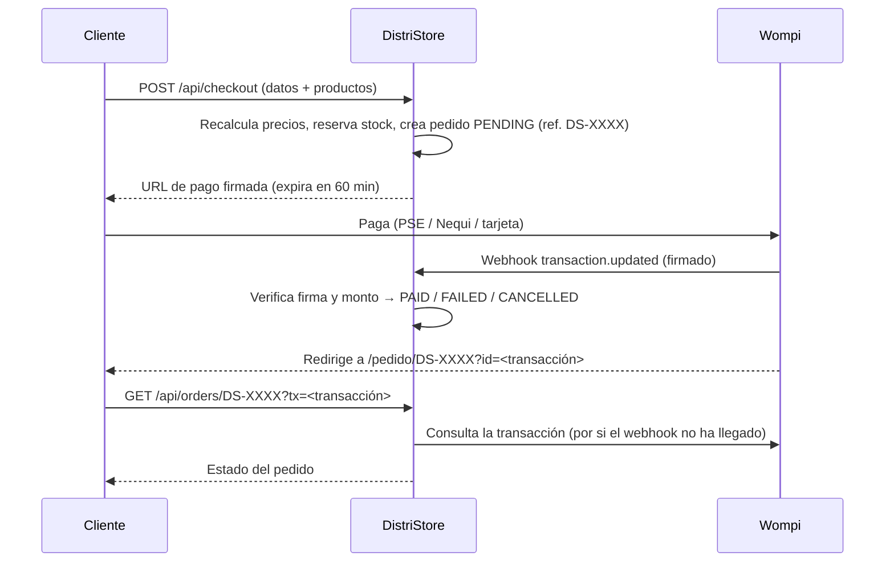
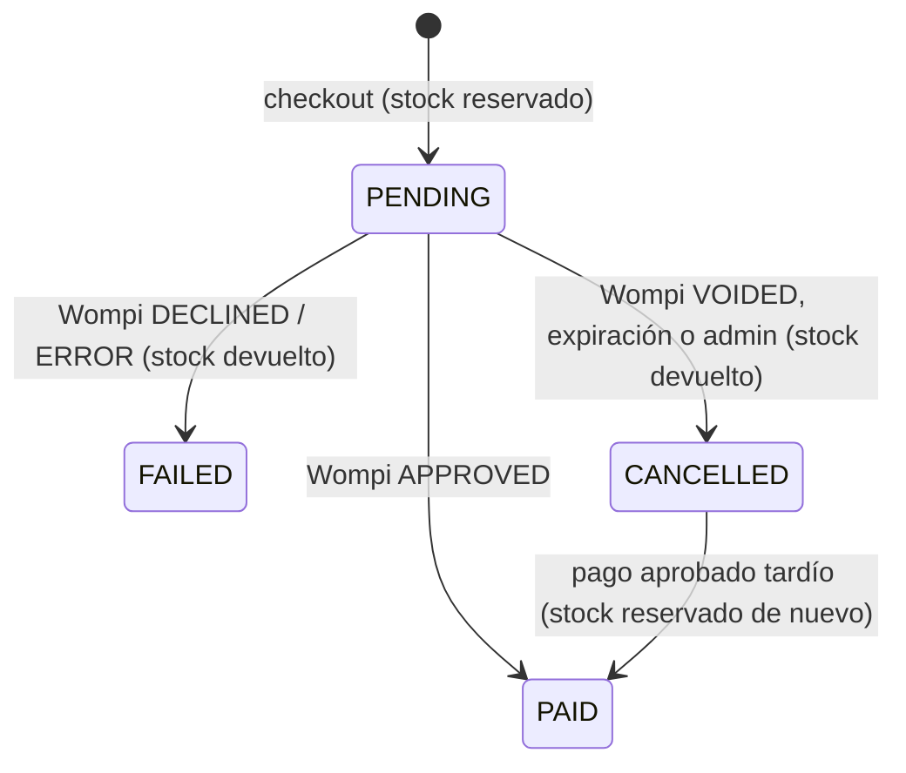

# DistriStore

Tienda en línea para una ferretería en Bogotá, construida con **Next.js 16 (App Router)**, **Prisma 7** y **PostgreSQL**. Incluye:

- Catálogo con categorías, subcategorías, marcas, ofertas y buscador.
- Carrito de compras y checkout como invitado (sin crear cuenta).
- Pagos en línea con **Wompi**: PSE, Nequi, tarjetas y Bancolombia.
- Panel de administración: productos, banners, categorías, marcas y pedidos.
- Correos de confirmación con **Resend** (opcional).
- Pedido manual por **WhatsApp** como canal alternativo.

---

## Índice

1. [Stack](#stack)
2. [Puesta en marcha local](#puesta-en-marcha-local)
3. [Variables de entorno](#variables-de-entorno)
4. [Estructura del proyecto](#estructura-del-proyecto)
5. [Cómo funciona la tienda](#cómo-funciona-la-tienda)
6. [Cómo funciona el pago (Wompi)](#cómo-funciona-el-pago-wompi)
7. [Inventario y estados del pedido](#inventario-y-estados-del-pedido)
8. [Panel de administración](#panel-de-administración)
9. [API](#api)
10. [Base de datos](#base-de-datos)
11. [Seguridad](#seguridad)
12. [Activar Wompi y probar en sandbox](#activar-wompi-y-probar-en-sandbox)
13. [Despliegue en Vercel](#despliegue-en-vercel)
14. [Solución de problemas](#solución-de-problemas)
15. [Pendientes conocidos](#pendientes-conocidos)

---

## Stack

| Capa | Tecnología |
|---|---|
| Framework | Next.js 16 (App Router, Turbopack) + React 19 + TypeScript |
| Estilos | Tailwind CSS 4 (modo claro/oscuro) |
| Base de datos | PostgreSQL (Prisma Postgres) con Prisma 7 + `@prisma/adapter-pg` |
| Imágenes | Vercel Blob |
| Pagos | Wompi (Web Checkout hospedado) |
| Correos | Resend |
| Autenticación del admin | `bcryptjs` (hash de la contraseña) + JWT firmado con `jose` |
| Validación | `zod` |
| Hosting | Vercel |

## Puesta en marcha local

Requisitos: **Node.js 20+** y una base de datos PostgreSQL.

```bash
npm install                 # instala dependencias (y ejecuta prisma generate)
cp .env.example .env.local  # luego completa los valores (ver abajo)
npx prisma migrate deploy   # crea o actualiza las tablas
npm run db:seed             # (opcional) 3 productos de ejemplo; BORRA los productos existentes
npm run dev                 # http://localhost:3000
```

| Script | Qué hace |
|---|---|
| `npm run dev` | Servidor de desarrollo |
| `npm run build` / `npm start` | Build y servidor de producción |
| `npm run lint` | ESLint |
| `npm run db:seed` | Datos de ejemplo. **Borra todos los productos** y no corre con `NODE_ENV=production` |

## Variables de entorno

En local van en `.env.local`, que tiene prioridad sobre `.env`. En producción se configuran en **Vercel → Settings → Environment Variables**. Ningún archivo `.env*` se sube al repositorio, excepto `.env.example`.

| Variable | Obligatoria | Descripción |
|---|---|---|
| `DATABASE_URL` | Sí | Conexión a PostgreSQL. Debe incluir `sslmode=require` |
| `ADMIN_PASSWORD_HASH` | Sí | Hash **bcrypt** de la contraseña del admin (ver nota abajo) |
| `SESSION_SECRET` | Sí | Secreto para firmar la sesión del admin. Generarlo con `openssl rand -hex 32` |
| `BLOB_READ_WRITE_TOKEN` | Sí (subir imágenes) | Token de Vercel Blob |
| `NEXT_PUBLIC_WOMPI_PUBLIC_KEY` | Sí (pagos) | Llave pública: `pub_test_...` (sandbox) o `pub_prod_...` (producción). Define también qué API de Wompi se consulta |
| `WOMPI_INTEGRITY_SECRET` | Sí (pagos) | Secreto de integridad. **Solo servidor** |
| `WOMPI_EVENTS_SECRET` | Sí (pagos) | Secreto de eventos, usado para verificar el webhook. **Solo servidor** |
| `NEXT_PUBLIC_SITE_URL` | Sí (pagos) | URL pública **sin `/` final**, por ejemplo `https://distristore.com`. Se usa en la redirección de Wompi y en los correos |
| `RESEND_API_KEY` | No | Activa los correos. Si falta, los correos se omiten |
| `ORDER_NOTIFICATIONS_FROM_EMAIL` | No | Remitente de los correos (de un dominio verificado en Resend) |

> **Importante: el `$` del hash bcrypt.** Next.js interpreta `$` dentro de `.env` como una variable, así que un hash como `$2b$12$...` queda **vacío** y el login del admin falla con *"ADMIN_PASSWORD_HASH no configurada"*. En los archivos `.env` / `.env.local` hay que escapar cada `$` y usar comillas dobles:
>
> ```
> ADMIN_PASSWORD_HASH="\$2b\$12\$xxxxxxxxxxxxxxxxxxxxxxxxxxxxxxxxxxxxxxxxxxxxxxxxxxxxx"
> ```
>
> En el panel de Vercel se pega **sin** barras invertidas.
>
> Para generar el hash: `node -e "console.log(require('bcryptjs').hashSync('tu-contraseña', 12))"`

Si faltan las variables de Wompi, la tienda funciona igual, pero el botón **Pagar pedido** responde *"Los pagos en línea no están disponibles"* y el cliente puede finalizar por WhatsApp.

## Estructura del proyecto

```
app/
  layout.tsx                  Layout raíz: fuente, tema claro/oscuro, CartProvider
  (store)/                    Tienda pública (Navbar + Footer + botón de WhatsApp)
    page.tsx                  Inicio: banners, categorías y productos
    productos/page.tsx        Catálogo con filtros (?categoria= &subcategoria= &marca= &q= &oferta=1)
    productos/[id]/page.tsx   Detalle de producto + relacionados
    marcas/page.tsx           Listado de marcas
    carrito/page.tsx          Carrito + formulario de checkout
    pedido/[reference]/       Estado del pedido (la página a la que vuelve Wompi)
  (admin)/admin/
    login/                    Login del admin
    page.tsx                  Productos, banners, categorías y marcas
    pedidos/                  Listado y gestión de pedidos
  api/                        Rutas API (ver sección API)
components/                   Navbar, Footer, ProductCard, CatalogClient, HeroCarousel, WhatsAppButton
src/context/
  CartContext.tsx             Estado del carrito (guardado en localStorage)
  ThemeContext.tsx            Tema claro/oscuro
lib/
  auth.ts                     Sesión del admin (JWT), bloqueo por intentos fallidos
  data.ts                     Lectura y escritura del catálogo
  orders.ts                   Pedidos: creación, reserva de stock, estados, expiración
  wompi.ts                    Firma de integridad, URL de checkout, verificación del webhook, consulta de transacciones
  email.ts                    Correos con Resend (HTML escapado)
  validation.ts               Esquemas zod y validadores
  rateLimit.ts                Límite de peticiones en memoria (checkout)
  site.ts                     Datos del negocio: teléfono, dirección, mapa
  db.ts                       Cliente Prisma
proxy.ts                      Protege /admin/* (redirige a /admin/login si no hay sesión)
next.config.ts                Cabeceras de seguridad (CSP, HSTS…) y dominios de imágenes
prisma/
  schema.prisma               Modelos
  migrations/                 Migraciones SQL
  seed.ts                     Datos de ejemplo
```

## Cómo funciona la tienda

**Catálogo.** Las páginas se renderizan en el servidor con datos frescos (`force-dynamic`), así que los cambios del admin se ven sin volver a desplegar. Los filtros del catálogo se pueden compartir por URL, por ejemplo `/productos?categoria=Eléctricas&oferta=1`.

**Precio con descuento.** El precio final es `round(precio × (1 − descuento/100))`. Se muestra en la tienda, pero **al pagar se vuelve a calcular en el servidor**: el precio que llega desde el navegador nunca se usa.

**Disponibilidad.** Un producto se puede comprar solo si `stock = true` **y** `quantity > 0`. Si no, se muestra *Agotado / Sin stock*.

**Carrito.**
- Se guarda en `localStorage` (`distri-cart`) y se valida al cargar, por si el dato está dañado o manipulado.
- Permite cambiar cantidades (máximo 99 por producto).
- **Solo se vacía cuando el pago queda confirmado.** Si el pago falla, el cliente conserva sus productos.

**WhatsApp.** El botón *"O finalizar por WhatsApp"* arma un mensaje con el pedido y abre `wa.me`. No crea un pedido en la base de datos ni reserva stock.

**Datos del negocio.** Teléfono, WhatsApp, dirección, horario y coordenadas del mapa están en `lib/site.ts`.

## Cómo funciona el pago (Wompi)



Paso a paso:

1. **Checkout** (`POST /api/checkout`):
   - Tiene un límite de 8 intentos cada 10 minutos por IP.
   - Valida los datos con zod.
   - Cancela los pedidos abandonados para liberar su stock.
   - Crea el pedido.
2. **Creación del pedido** (`lib/orders.ts → createOrder`):
   - Une los productos repetidos del carrito.
   - Calcula el total con los precios de la base de datos.
   - **Reserva el stock de forma atómica**: si dos clientes compran la última unidad a la vez, solo uno lo consigue.
   - Guarda el pedido como `PENDING` con una **referencia aleatoria** `DS-<24 hex>`. Esa referencia identifica el pedido ante Wompi y en la URL pública.
3. **URL de pago** (`lib/wompi.ts → buildWompiCheckoutUrl`):
   - Va firmada con `SHA256(referencia + monto en centavos + COP + expiración + secreto de integridad)`.
   - Expira a los **60 minutos**.
   - Se envía prellenada con el nombre, correo, teléfono y dirección del cliente.
4. **Webhook** (`POST /api/webhooks/wompi`):
   - Verifica el checksum: `SHA256(valores de signature.properties tomados de data + timestamp + secreto de eventos)`.
   - Procesa solo `transaction.updated`.
   - Es **idempotente**: Wompi reintenta los webhooks, y aplicar el mismo evento dos veces no cambia nada.
   - Exige que el monto cobrado sea **exactamente** el total del pedido.
5. **Vuelta del cliente** (`/pedido/<referencia>?id=<transacción>`):
   - La página consulta la transacción **directamente a la API de Wompi**, así el cliente ve el resultado aunque el webhook tarde.
   - Si sigue pendiente (PSE puede demorar), vuelve a consultar cada 5 segundos durante unos 2 minutos.
6. **Correos:**
   - "Pedido recibido" al crear el pedido.
   - "Pago confirmado" al cliente y "Nuevo pago" al admin (`site.email`), **una sola vez**, cuando el pedido pasa a `PAID`.

## Inventario y estados del pedido



| Estado | Significado | Stock |
|---|---|---|
| `PENDING` | Esperando el pago | Reservado |
| `PAID` | Pago confirmado. Un pedido `PAID` **nunca** cambia de estado | Descontado |
| `FAILED` | Pago rechazado o con error | Devuelto |
| `CANCELLED` | Anulado en Wompi, expirado o cancelado por el admin | Devuelto |

Reglas:

- **Expiración:** los pedidos `PENDING` con más de **70 minutos** (60 del checkout más 10 de margen para webhooks rezagados) se cancelan solos y devuelven el stock. No hace falta un cron: se revisa en cada checkout y al abrir `/admin/pedidos`.
- **Devolución única:** el stock se devuelve una sola vez por pedido (campo `stockReleased`).
- **Monto que no coincide:** si Wompi reporta un monto distinto al esperado, el pedido **queda `PENDING`** y se registra `[wompi] MONTO NO COINCIDE` en los logs para revisarlo a mano.

## Panel de administración

- **Acceso:** `/admin/login` con la contraseña cuyo hash está en `ADMIN_PASSWORD_HASH`.
  - La sesión dura 7 días (cookie `admin_session`, httpOnly, SameSite strict).
  - Después de **5 intentos fallidos** la IP queda bloqueada **15 minutos** (tabla `LoginAttempt`).
- **Productos** (`/admin`):
  - Crear, editar y eliminar productos, con buscador, filtros, orden y paginación.
  - Hasta 6 imágenes por producto. Se comprimen a WebP en el navegador antes de subirlas.
  - Campos: precio, descuento %, referencia, marca, categoría, subcategoría, `stock` (interruptor) y `quantity` (unidades disponibles).
- **Banners, categorías y marcas:** desde los botones del encabezado.
- **Pedidos** (`/admin/pedidos`):
  - Filtro por estado y detalle del cliente: teléfono, correo, dirección, método de pago y transacción Wompi.
  - Botón para escribirle al cliente por WhatsApp.
  - **Cancelar** un pedido pendiente, lo que devuelve el stock.

## API

| Método y ruta | Acceso | Descripción |
|---|---|---|
| `GET /api/products`, `GET /api/products/:id` | Público | Catálogo |
| `POST /api/products`, `PUT/DELETE /api/products/:id` | Admin | CRUD de productos. El `PUT` es parcial: solo cambia lo que se envía |
| `GET/POST /api/banners`, `PUT/DELETE /api/banners/:id` | GET público / resto admin | Banners |
| `GET/POST /api/brands`, `PUT/DELETE /api/brands/:id` | GET público / resto admin | Marcas |
| `GET/POST /api/categories`, `PUT/DELETE /api/categories/:id` | GET público / resto admin | Categorías |
| `POST /api/subcategories`, `DELETE /api/subcategories/:id` | Admin | Subcategorías |
| `POST /api/upload` | Admin | Sube una imagen a Vercel Blob (JPG, PNG, WebP, GIF, AVIF; máximo 5 MB; **sin SVG**) |
| `POST /api/admin/login`, `POST /api/admin/logout` | Público | Sesión del admin |
| `POST /api/checkout` | Público (con rate limit) | Crea el pedido y devuelve `paymentUrl` |
| `GET /api/orders/:reference[?tx=]` | Quien tenga la referencia | Estado público del pedido. Con `tx` sincroniza con Wompi |
| `POST /api/webhooks/wompi` | Wompi (firma verificada) | Eventos de pago |
| `GET /api/admin/orders?status=&page=` | Admin | Listado de pedidos (20 por página) |
| `PATCH /api/admin/orders/:id` `{ "action": "cancel" }` | Admin | Cancela un pedido `PENDING` |

## Base de datos

Modelos (`prisma/schema.prisma`):

- **`Product`**: `name`, `price` (en pesos, entero), `images[]`, `desc`, `category`, `subcategory`, `reference`, `brand`, `discount` (%), `stock`, `quantity`.
- **`Banner`**, **`Brand`**, **`Category`** y **`Subcategory`**: contenido del catálogo.
- **`Order`**: `reference` (única, aleatoria), datos del cliente, `total` (pesos), `status`, `wompiReference` (id de la transacción), `paymentMethod`, `stockReleased`, fechas.
- **`OrderItem`**: copia del nombre, el precio unitario y la cantidad al momento de la compra. Si luego cambias el producto, el pedido no se altera.
- **`LoginAttempt`**: control de intentos de login por IP.

Migraciones:

```bash
npx prisma migrate deploy        # aplica las pendientes (local y producción)
npx prisma migrate dev --name x  # crea una nueva después de cambiar schema.prisma (solo en desarrollo)
```

> Si la base de datos no responde, las páginas del catálogo muestran 3 productos de ejemplo (`mockProducts` en `lib/data.ts`) en vez de fallar. El checkout **siempre** usa la base de datos real.

## Seguridad

- **Admin:** contraseña con bcrypt, sesión JWT firmada con expiración, bloqueo por intentos fallidos y `/admin/*` protegido por `proxy.ts`.
- **Precios:** se calculan siempre en el servidor y se verifica que el monto pagado coincida exactamente con el total.
- **Wompi:**
  - Firma de integridad con expiración.
  - Checksum del webhook comparado en tiempo constante.
  - Procesamiento idempotente: un pedido pagado nunca retrocede de estado.
- **Pedidos no enumerables:** se consultan por una referencia aleatoria de 96 bits, nunca por el id secuencial.
- **Inventario:**
  - Reserva atómica, sin sobreventa ni cantidades negativas.
  - Rate limit en el checkout, para que un bot no pueda vaciar el stock.
  - Expiración automática de pedidos abandonados.
- **Validación con zod:**
  - Productos, banners y checkout pasan por esquemas zod.
  - Los ids numéricos se validan en todas las rutas.
  - Las imágenes solo aceptan URLs `https://` o rutas locales.
- **Subidas:** sin SVG (podría ejecutar JavaScript) y con nombre de archivo saneado.
- **Correos:** HTML escapado para evitar inyección con el nombre o la dirección del cliente.
- **Cabeceras** (`next.config.ts`):
  - CSP: Wompi y OpenStreetMap permitidos, y `unsafe-eval` solo en desarrollo.
  - HSTS, `X-Frame-Options: DENY`, `nosniff`, `Referrer-Policy` y `Permissions-Policy`.
- **Base de datos:** conexión con TLS (`sslmode=require`).

## Activar Wompi y probar en sandbox

1. Crea la cuenta de comercio en [comercios.wompi.co](https://comercios.wompi.co).
2. En **Desarrolladores**, copia las llaves de **sandbox** a `.env.local`:
   - Llave pública → `NEXT_PUBLIC_WOMPI_PUBLIC_KEY`.
   - Secreto de integridad → `WOMPI_INTEGRITY_SECRET`.
   - Secreto de eventos → `WOMPI_EVENTS_SECRET`.
3. En **URL de eventos**, configura `https://<tu-dominio>/api/webhooks/wompi`.
   - En local, Wompi no puede llegar a `localhost`. Usa un túnel (por ejemplo `ngrok http 3000`) o prueba directamente en un deploy de preview de Vercel.
   - Aun sin webhook, la página del pedido se sincroniza consultando la API de Wompi.
4. Haz compras de prueba ([datos de sandbox de Wompi](https://docs.wompi.co/en/docs/colombia/datos-de-prueba-en-sandbox/)):

   | Método | Aprobado | Rechazado |
   |---|---|---|
   | Tarjeta (cualquier fecha futura y CVC de 3 dígitos) | `4242 4242 4242 4242` | `4111 1111 1111 1111` |
   | Nequi | `3991111111` | `3992222222` |
   | PSE | "Banco que aprueba" | "Banco que rechaza" |

5. Verifica:
   - El pedido aparece `PAID` o `FAILED` en `/admin/pedidos`.
   - El stock baja o se devuelve según el resultado.
   - El carrito se vacía solo cuando el pago fue aprobado.
6. Para salir a producción, cambia las tres llaves por las de producción (`pub_prod_...`, etc.) y vuelve a hacer una compra real de bajo valor.

## Despliegue en Vercel

1. Configura **todas** las variables de entorno en Vercel. Recuerda: el hash bcrypt se pega **sin** barras invertidas.
2. Aplica las migraciones contra la base de producción: `npx prisma migrate deploy` (con la `DATABASE_URL` de producción).
3. Despliega. `npm install` ejecuta `prisma generate` automáticamente (`postinstall`).
4. Actualiza la URL de eventos en Wompi con el dominio final.

## Solución de problemas

| Síntoma | Causa probable |
|---|---|
| El login dice *"ADMIN_PASSWORD_HASH no configurada"* | Falta la variable, o en `.env` el hash no tiene los `$` escapados (ver [Variables de entorno](#variables-de-entorno)) |
| `/admin` da error 500 | Falta `SESSION_SECRET` |
| *"Los pagos en línea no están disponibles"* | Falta `NEXT_PUBLIC_WOMPI_PUBLIC_KEY`, `WOMPI_INTEGRITY_SECRET` o `NEXT_PUBLIC_SITE_URL` |
| Wompi muestra *"firma inválida"* | `WOMPI_INTEGRITY_SECRET` no corresponde a la llave pública, por ejemplo sandbox mezclado con producción |
| Los pedidos se quedan en `PENDING` | La URL de eventos no está configurada en Wompi o el webhook responde 401 por un `WOMPI_EVENTS_SECRET` incorrecto. Revisa los logs de Vercel |
| Un producto aparece "Agotado" aunque `stock` está activo | Su `quantity` es 0. Carga las unidades en el admin |
| *"Solo quedan N unidades…"* al pagar | Otro cliente compró o tiene reservadas unidades. Se liberan si su pago falla o expira |
| El mapa del footer no carga | La CSP bloquea el dominio; está permitido `https://www.openstreetmap.org` |

## Pendientes conocidos

- El rate limit del checkout es en memoria (por instancia de Vercel). Para algo más robusto, usar Upstash Redis o Vercel KV.
- Los pagos con monto distinto al esperado solo quedan registrados en los logs; no hay alerta en el admin.
- No hay estados de despacho (`ENVIADO`, `ENTREGADO`). El flujo termina en `PAID`.
- `src/context/ThemeContext.tsx` tiene una advertencia de ESLint (`set-state-in-effect`).
- No hay pruebas automatizadas en el repositorio.
